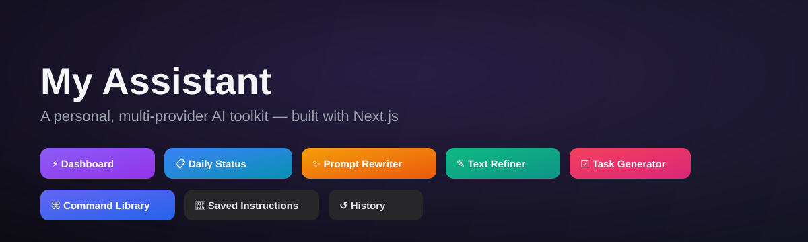
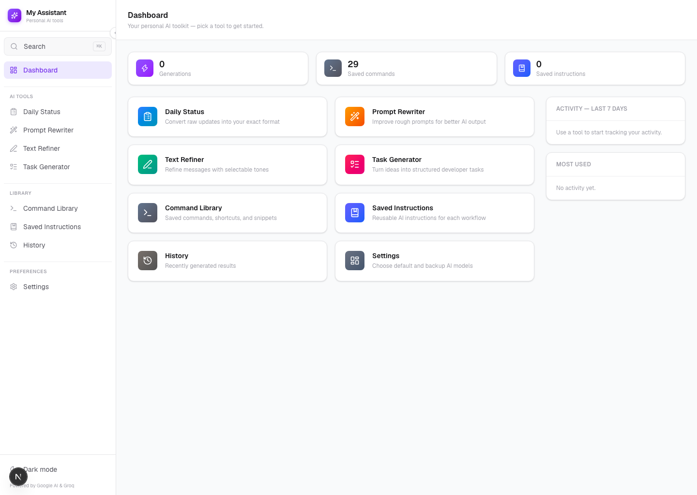
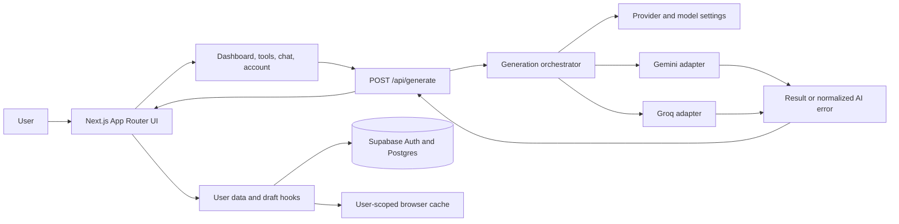
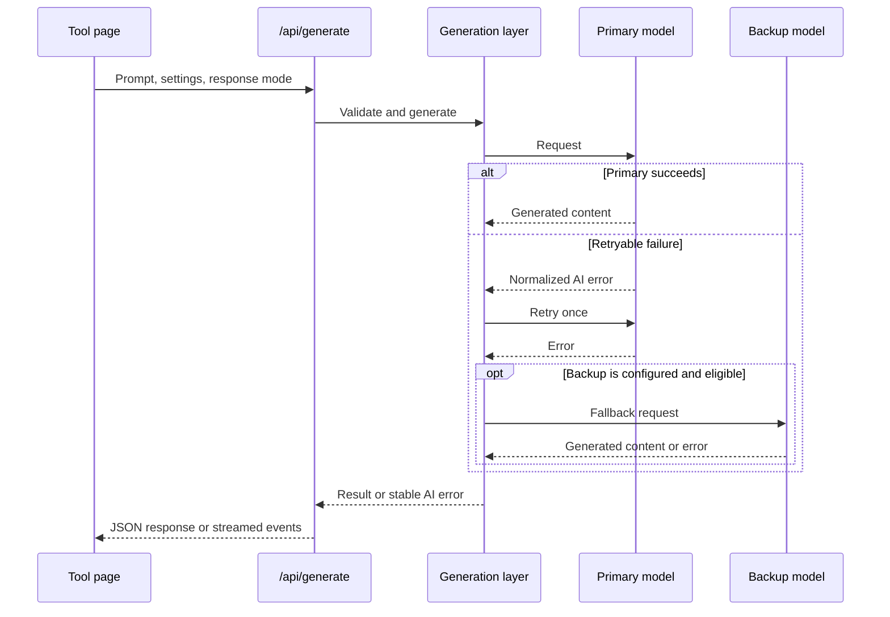
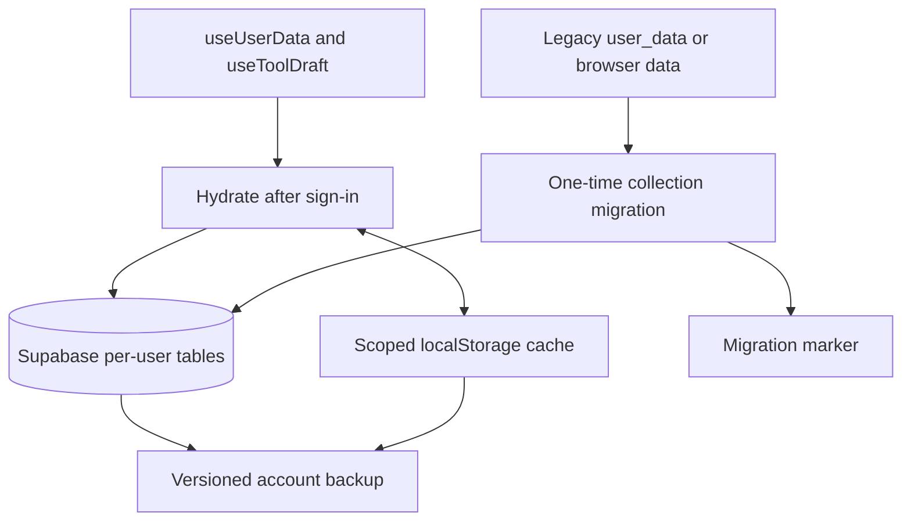

<div align="center">



# My Assistant

### A focused workspace for AI-assisted writing, planning, and everyday development tasks.

[](https://nextjs.org)
[](https://react.dev)
[](https://www.typescriptlang.org)
[](https://tailwindcss.com)
[](https://ai.google.dev)
[](https://groq.com)

</div>

---

## Overview

My Assistant brings a set of practical AI workflows into one personal productivity dashboard. Use focused tools for common writing and planning jobs, or describe a goal in Command Center and let the app route it to a specialist workflow. Chat provides a separate, general-purpose conversation experience.

The app supports Google Gemini and Groq. Choose a primary model and an optional backup in Settings; the shared generation layer handles retries and provider fallback.

<p align="center">
  
</p>

## Product areas

| Area | Purpose |
| --- | --- |
| **Dashboard** | View activity, usage, and shortcuts to the tools. |
| **Command Center** | Route a goal to the right specialist tool, then run that tool's workflow. |
| **Chat** | Hold persistent, multi-turn conversations with an AI model. |
| **Daily Status** | Turn rough notes into a clear status update. |
| **Prompt Rewriter** | Improve the clarity and usefulness of a draft prompt. |
| **Text Refiner** | Rewrite text in a selected tone or style. |
| **Task Generator** | Convert an idea or request into structured, actionable tasks. |
| **Command Library** | Save and search shell commands, shortcuts, and snippets. |
| **Saved Instructions** | Keep reusable instructions for recurring workflows. |
| **History** | Revisit and copy previous AI generations. |
| **Settings** | Configure provider, primary model, and optional backup model. |
| **Account** | Manage profile and security details, and export or import app data. |

### Command Center and Chat

These experiences serve different workflows:

- **Command Center** is task-oriented. An orchestration request selects a specialist tool; a second request runs that tool with its own prompt and settings.
- **Chat** is conversation-oriented. It sends messages directly to the selected model without tool routing or specialist templates.

The shared interface also includes a command palette, copy actions, responsive navigation, and reusable tool components.

## Architecture

### Application and AI request flow



All AI tools use the same API route and generation layer. Provider adapters are deliberately thin; retry, timeout, fallback, and callback behavior live in the shared orchestrator so they stay consistent across providers. The API supports standard JSON responses and server-sent event streaming.

### Generation lifecycle



Transient network and server errors are retried once on the same model before eligible fallback. Cancellation stops the request flow. See [`src/lib/ai/generate.ts`](src/lib/ai/generate.ts), [`src/lib/ai/errors.ts`](src/lib/ai/errors.ts), and [`src/lib/ai/callbacks.ts`](src/lib/ai/callbacks.ts) for the behavior and contracts.

### Persistence model



Supabase is the cross-device source for signed-in data. A user-scoped local cache supports quick startup and one-time imports from legacy storage. Collection migration markers prevent old browser values from restoring records that were later removed. Database policies restrict each signed-in user to their own rows.

## Technology

| Layer | Technologies |
| --- | --- |
| Application | Next.js 16 App Router, React 19, TypeScript |
| Styling and interaction | Tailwind CSS v4, Framer Motion, Radix UI, cmdk, lucide-react |
| AI providers | Google GenAI SDK, Groq SDK |
| Authentication and persistence | Supabase JS, Supabase SSR, PostgreSQL |
| Rich output | react-markdown, remark-gfm, rehype-highlight |

## Getting started

### Requirements

- Node.js compatible with the installed Next.js release
- npm
- Gemini and/or Groq API credentials for AI generation
- A Supabase project for authentication and cloud persistence

### 1. Install dependencies

```bash
git clone <repository-url>
cd assistant
npm install
```

### 2. Configure environment variables

Copy the example file and provide the values for your services:

```bash
cp .env.example .env.local
```

| Variable | Purpose |
| --- | --- |
| `GEMINI_API_KEY` | Server-side credential for Google Gemini. |
| `GROQ_API_KEY` | Server-side credential for Groq. |
| `NEXT_PUBLIC_SUPABASE_URL` | Supabase project URL. |
| `NEXT_PUBLIC_SUPABASE_PUBLISHABLE_KEY` | Supabase publishable key used by the client. |
| `NEXT_PUBLIC_SITE_URL` | Optional site origin for auth links; defaults to the current request origin. |

Create provider keys in [Google AI Studio](https://aistudio.google.com/apikey) and the [Groq Console](https://console.groq.com/keys). At least one provider key is needed to generate content. Provider model availability changes over time; configure models in Settings and use `npm run audit:models` to check them against your credentials.

### 3. Configure Supabase

1. Create a project in [Supabase](https://supabase.com/) and add its URL and publishable key to `.env.local`.
2. In the Supabase SQL Editor, run [`src/lib/supabase/schema.sql`](src/lib/supabase/schema.sql) for the legacy base schema.
3. If the project already has data in `public.user_data`, run [`src/lib/supabase/2026-10-18-expand-collections.sql`](src/lib/supabase/2026-10-18-expand-collections.sql) when needed. This migration permits the current collection values while preserving existing rows.
4. Run [`src/lib/supabase/2026-10-18-normalize-user-data.sql`](src/lib/supabase/2026-10-18-normalize-user-data.sql). It creates normalized tables, enables per-user row-level security, and copies existing records without dropping the legacy table.
5. In **Authentication → URL Configuration**, allow `http://localhost:3000/auth/callback`. Add the deployed callback URL after deployment and set `NEXT_PUBLIC_SITE_URL` to the site origin.
6. Configure email confirmation and password recovery in Supabase Authentication.

The app provides `/login`, `/signup`, and `/forgot-password`. Profile and security controls are on `/account`; password recovery links open `/account/update-password`.

### 4. Start the development server

```bash
npm run dev
```

Open [http://localhost:3000](http://localhost:3000).

## Data and security

- Saved commands, instructions, generation history, conversation messages, settings, and drafts use the persistence hooks in [`src/lib/hooks/useUserData.ts`](src/lib/hooks/useUserData.ts) and [`src/lib/hooks/useToolDraft.ts`](src/lib/hooks/useToolDraft.ts).
- The Account page can create and restore versioned JSON backups. A backup can contain private saved text, including credentials a user chose to store in instructions, as well as profile information. It does not contain account passwords or server-side provider API keys.
- Prompts and generated output are sent to the selected AI provider to complete a request.
- Provider API keys must remain in server-side environment variables. Never expose a Supabase secret or service-role key through a `NEXT_PUBLIC_` variable.

## Development commands

| Command | Description |
| --- | --- |
| `npm run dev` | Start the local development server. |
| `npm run build` | Create a production build. |
| `npm run start` | Serve the production build. |
| `npm run lint` | Run ESLint. |
| `npm test` | Run offline tests with mocked providers. |
| `npm run test:live` | Exercise configured models with real provider calls. |
| `npm run audit:models` | Check whether configured model IDs respond with the configured keys. |
| `npm run probe:models` | Discover and probe models available to configured keys. |
| `npm run probe:reliability` | Measure repeated request pass rates and latency. |
| `npm run probe:quality` | Compare output quality across model candidates. |

> **Live-call notice:** `test:live` and all `probe:*` / `audit:models` commands make real, potentially metered provider requests. They require the relevant API keys. `npm test` is offline.

## Deployment

Deploy the app to a hosting platform that supports the installed Next.js version. Set the server-side provider keys and Supabase environment values in the host configuration, then add the production `/auth/callback` URL in Supabase Authentication. Set `NEXT_PUBLIC_SITE_URL` to the public site origin. Review the hosting provider's current runtime and environment-variable guidance before deploying.

## Repository map

```text
src/
├── app/                    Routes, tool pages, auth screens, and API handlers
│   ├── api/generate/       Shared JSON and streaming generation endpoint
│   ├── command-center/     Tool-routing workflow
│   ├── prompt-rewriter/    Prompt improvement workflow
│   ├── text-refiner/       Tone and style refinement workflow
│   └── task-generator/     Structured task generation workflow
├── components/
│   ├── auth/               Account, sign-in, and data-management UI
│   ├── layout/             App shell, navigation, and command palette
│   ├── tools/              Shared components for AI workflows
│   └── ui/                 Reusable interface primitives
├── lib/
│   ├── ai/                 Orchestration, errors, callbacks, and provider adapters
│   ├── hooks/              User data, drafts, and persistence behavior
│   └── supabase/           Client setup, middleware, schema, and migrations
└── types/                  Shared TypeScript types
```

## License

This repository is a personal productivity project. Add a license file if you plan to distribute or reuse it under specific terms.

---

<div align="center">
<sub>Built for focused, repeatable AI workflows.</sub>
</div>
